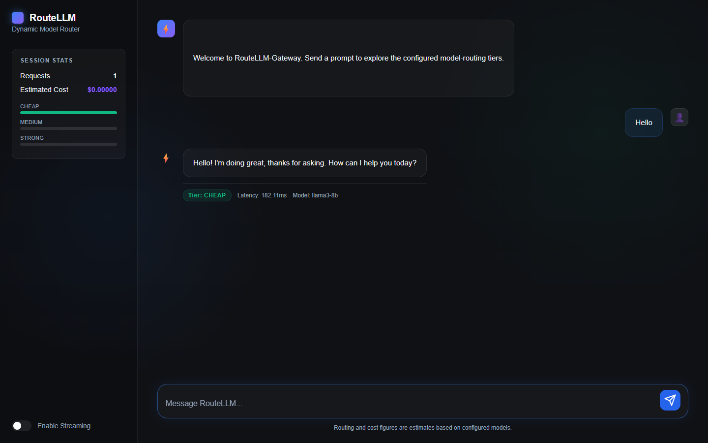
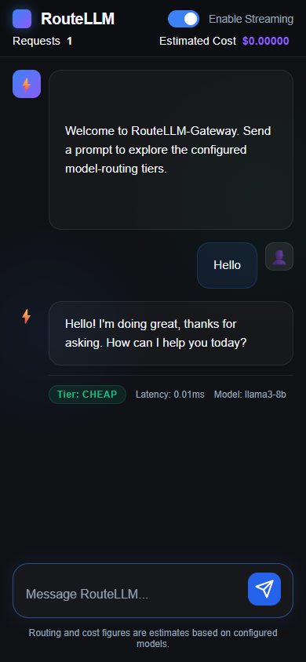
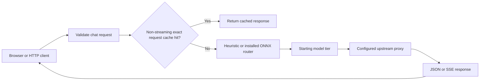

# RouteLLM-Gateway

A FastAPI prototype that routes chat requests among configured model tiers, proxies responses, and serves a small chat interface. Without a trained ONNX checkpoint it uses keyword heuristics. It implements part of the chat-completions API shape; it is not a complete OpenAI API replacement or evidence of a particular cost saving or answer quality.

## Actual local interface





These Edge captures show the real gateway and frontend talking to this repository's local `mock_server`. The reply is a fixed demonstration response, not output from Llama or another model. The model label comes from the configured tier registry. Cache was disabled, the router used heuristics, provider keys were cleared, and external browser requests were blocked. Displayed timings and costs are not benchmarks or billing measurements.

## Request path



The HTTP cache now matches the complete validated messages, requested model and generation settings. It uses a versioned exact-match key and does not load an embedding model. Prompt-only and approximate semantic matching could return a response from a different system prompt or conversation, so they are not used by the HTTP handler. The standalone semantic-cache implementation remains experimental.

## Run without a model or paid provider

Use Python 3.10+ and a fresh development environment. The smaller dependency set avoids the training/embedding packages:

```powershell
python -m venv .venv
.\.venv\Scripts\Activate.ps1
python -m pip install -r requirements-smoke.txt
python -m uvicorn gateway.mock_server:app --host 127.0.0.1 --port 9000
```

Leave that terminal running. In a second terminal, activate the same environment and run:

```powershell
$env:DEV_MODE='true'
$env:CACHE_ENABLED='false'
$env:LOCAL_MODEL_BASE_URL='http://127.0.0.1:9000/v1'
$env:ROUTER_MODEL_PATH='.\offline-demo-no-checkpoint.onnx'
python -m uvicorn gateway.main:app --host 127.0.0.1 --port 8000
```

Open [the local chat](http://127.0.0.1:8000/), send `Hello`, and try streaming on or off. `DEV_MODE=true` redirects every registry tier to the local endpoint; the mock server returns canned text. Keep the named router checkpoint absent for this heuristic-only example. Installing dependencies can require network access, but the demonstrated chat path does not require a model download, Redis or provider credentials. On macOS/Linux use the equivalent environment-variable exports and `.venv/bin/activate`.

## Configure real integrations separately

`gateway/config.py` defines model IDs, tiers, endpoints and hardcoded price estimates. `.env.example` lists configuration fields. Enabling a real provider can send conversation data outside the machine and incur charges; no provider was exercised in this repair. Verify model availability, credentials and prices independently before use.

For Redis, use a dedicated local instance and review retention: responses may contain private conversation data. Authentication and tenant isolation are not implemented. Identical request matching does not establish a multiuser privacy boundary. Disable caching or clear the appropriate cache when changing service/provider configuration. The old prompt-only entries are not reused by the new versioned HTTP key.

The default host and Compose-published ports are loopback-only. The bundled frontend uses the same origin; the API no longer grants wildcard cross-origin browser access. These defaults are not authentication. Do not expose the service publicly without an independently reviewed access-control and resource-limit layer.

The full `requirements.txt` includes training, ONNX and embedding dependencies that can be substantially larger. `router/train.py` and evaluation scripts can download data/models or call providers; they were not run. Compose/Docker configuration exists, but a full image build and Redis integration were not verified here.

## Verification and repairs

```powershell
$env:CACHE_ENABLED='false'
$env:DEV_MODE='true'
python -m pytest tests/test_cache_context.py tests/test_gateway.py -q -k 'not valid_request_schema'
```

The bounded suite passed **21 tests**, with one upstream-request test deliberately excluded. Before repair, six cache-context cases failed, empty messages incorrectly reached the provider boundary, arbitrary browser origins received CORS access, and internal upstream errors were returned to clients. The added tests use actual HTTP handlers with explicit synthetic cache/provider boundaries. They make no provider requests and do not train/load a model. A Pydantic configuration deprecation warning remains.

The frontend also inserted user text, model text and model metadata as HTML. A real-browser regression created three injected image nodes and executed a synthetic event handler before repair. Messages and metadata now render as inert plain text, preserving line breaks without interpreting Markdown/HTML. The external Markdown renderer was removed. The regression passes and checks for horizontal overflow at 320, 390, 768 and 1440 pixels; the narrow-screen layout failed before its CSS repair.

Optional browser check, with Playwright and a local browser already installed:

```sh
python tests/smoke_frontend.py
```

Windows uses installed Edge; other platforms expect a Playwright Chromium installation. This renderer-security test uses a controlled local HTTP fixture. Separately, both streaming and non-streaming UI flows were exercised against the actual running gateway and committed mock server for the screenshots. Neither is a live-provider evaluation. CI runs the bounded HTTP suite using `requirements-smoke.txt`.

## Important remaining limits

- Routing is heuristic unless a separately trained compatible checkpoint is available. Classifier quality and reported cost-saving claims have not been independently reproduced.
- A named model currently selects its tier; the fallback proxy may choose the cheapest configured model in that tier. Do not assume exact provider/model pinning.
- Non-streaming fallback handles selected upstream errors. Streaming work begins when the iterator is consumed, so transparent mid-stream tier failover is not established. Streaming timing/cost metadata is partial, and the client parser still needs broader fragmented-SSE coverage.
- Messages contain strings only. Tools, multimodal inputs, structured-output modes and the complete OpenAI API surface are not implemented. The UI sends only its latest user message, not full conversation history.
- `/health` reports local component state, not provider readiness. Session statistics and registry prices are estimates, not a quality evaluation or billing meter.
- Full training/router suites, real Redis, production Docker deployment, rate limiting, tenant authorization and live providers remain unverified. Stream-error diagnostics still need a separate disclosure review.

## Source and rollback

`gateway/` contains configuration, routing, cache, middleware, proxy and local mock server. `frontend/` is the plain JavaScript chat. `router/` and `eval/` contain unexecuted training/evaluation paths. `tests/` contains the bounded regressions and existing suites.

This repair fixes context-sensitive caching, empty-input validation, browser HTML injection, permissive CORS and non-streaming error disclosure; restricts default exposure; adds narrow-screen/reduced-motion handling, offline CI and genuine screenshots; and replaces unsupported README claims. Revert the repair commit through normal history to undo it. No repository-wide license file is present, so this change adds no license grant.
